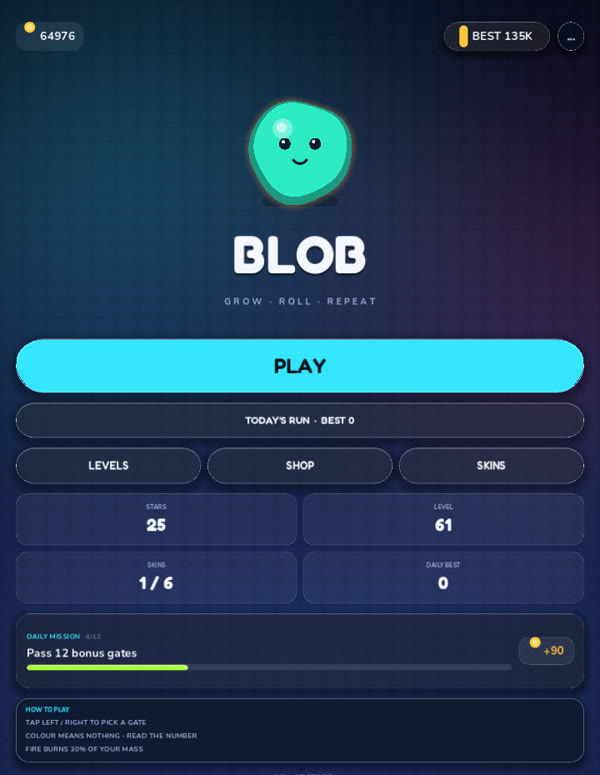
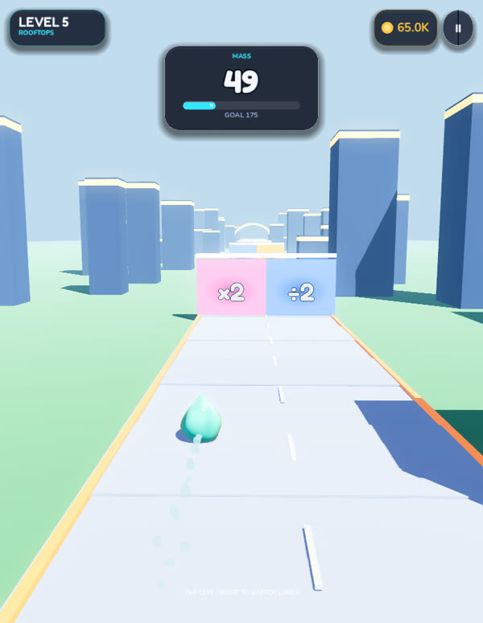
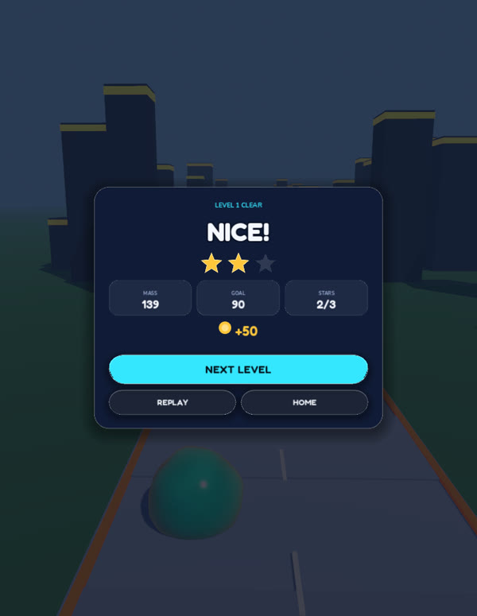

# Blob Run

A 3D hyper-casual runner for Android built with **Godot 4.7.2** and GDScript. Every mesh,
material, shader, UI widget and sound is generated from code at runtime, so the whole
project is plain text and builds headlessly from the command line.



## The hook

One stat matters: **mass**. You are not collecting soldiers or coins to spend mid-run —
you choose which gate to roll through, and every gate multiplies or divides your body.
Bigger means heavier, slower and easier to hit. The run ends when you roll down the ramp
into the pool, and your final mass is the score.

- **Two lanes.** Tap the left or right half of the screen, swipe, or press ← / → to
  switch. The blob never moves freely.
- **Rhythm.** Gate pairs sit exactly 48 units apart, so the run reads as an even beat.
- **Math gates.** Each pair puts one good operation in one lane and one bad operation in
  the other (`×2`, `+30`, `÷2`, `×0.7`, `−40%`). The chosen gate applies instantly.
- **Enemies.** Green spheres can be eaten, red ones kill. Colour resolves live against your
  radius, so a grown blob can suddenly eat what used to be lethal.
- **Fire.** Rows of flame that burn 30% of your mass; the burned mass curls off the drop as
  steam with its own hiss. From level 3 some fire rows slide across the track.
- **Pickups.** Turquoise shards give +15% mass, pink rings switch on an 8s magnet,
  blue bubbles add a shield, gold cubes make gates apply twice for 6s.
- **Combo.** Good gates in a row build a streak: 3 / 5 / 8 in a row pay +6 / +10 / +15%
  mass on top and show PERFECT ×N. A bad gate or a hit resets it.
- **Risk.** Mass grows the radius, slows the roll and makes steering heavier.
- **Feel.** Colour bursts on every gate and absorb, a particle trail behind the blob,
  radial speed streaks that build with mass, a short slow-motion + FOV punch when you switch
  lanes at the last moment, and a camera swoop at the start of every run.
- **Character.** The blob is a glossy teardrop, not a sphere: the silhouette tapers into a
  rounded tip in the vertex shader, a wet specular glint sits on top and the belly is darker
  like liquid. Gates carry additive glow halos, so the neon read survives the GL renderer.

Each level is a freshly generated track that gets longer and denser. Biomes rotate every
five levels (Rooftops, Grove, Canyon, Abyss) and every tenth level is a boss: a rival blob
that has to be outgrown before the finish.

## Progression

| System | What it does |
| --- | --- |
| Stars | 1★ finish, 2★ at 1.25× the goal, 3★ at 1.6× the goal |
| Coins | Final mass plus a bonus per star |
| Shop | Four permanent upgrades — Start Mass (5), Magnet (4), Lane Speed (4), Shield (2) |
| Skins | Six palettes, applied inside the blob shader |
| Missions | One daily objective (absorb blobs, clear levels, earn coins) with a coin reward |
| Daily run | TODAY'S RUN on the menu: one seeded track per day, pays coins, keeps a per-day best, never touches progression |
| Tutorial | First run on level 1 teaches tap-to-switch, take the green gate, dodge the red one |
| Continue | After a wipe you can pay coins (120, then 200) to resume the same run |
| Levels | Endless: the level list grows by itself, and every track is generated from its number |

Everything lives in `user://profile.json` and is written the moment it changes.

## Install

```bash
adb install -r build/blobrun-release.apk
```

Package `com.sahand.blobrun`, version `0.2.0` (versionCode 3), min SDK 24, target SDK 36,
arm64-v8a, signed with the release keystore in `build/`.

## Build from the command line

```bash
export ANDROID_HOME=~/Library/Android/sdk
G=~/.hermes/tools/godot/Godot472.app/Contents/MacOS/Godot

# signed release APK
"$G" --headless --path . --export-release "Android" build/blobrun-release.apk

# debug APK
"$G" --headless --path . --export-debug "Android" build/blobrun-debug.apk
```

The Android export templates for `4.7.2.stable` must be installed. Keystore, alias and
password are already referenced from `export_presets.cfg`.

## Layout

```
project.godot          project settings (720x1600, portrait, mobile renderer)
main.tscn              minimal scene: Node3D + scripts
scripts/game.gd        run loop, world generation, shaders, HUD, result panels
scripts/menu_ui.gd     menu, level select, shop, skins, settings
scripts/ui_kit.gd      palette, fonts, button/panel/star factories
scripts/profile.gd     save data: coins, stars, upgrades, skins, settings
scripts/sfx.gd         procedural WAV synthesis + music player
shaders/               blob, floor, sky and gate shaders
assets/fonts/          Fredoka + Nunito (UI), Vazirmatn (unused, kept)
assets/sfx/            generated pop / eat / hurt / win + music loop
```

## Development flags

Pass them after `--` so they reach `OS.get_cmdline_user_args()`:

```bash
"$G" --path . -- --screen=play --level=6 --autoplay --invincible
```

| Flag | Effect |
| --- | --- |
| `--screen=menu\|levels\|shop\|skins\|settings\|play\|boss\|win\|lose\|pause` | Jump straight to a screen |
| `--level=N` | Start at level N |
| `--autoplay` | Let the game steer itself (smoke tests, screenshots) |
| `--invincible` | Ignore spikes and red enemies |
| `--spike` | Force two spike rows near the start |
| `--nearmiss` | Fire the slow-motion near-miss once, for capture |
| `--autorevive` | Open the lose panel and press CONTINUE |
| `--shot --shot-delay=6` | Save a screenshot to `user://shot_000.png` and quit |
| `--unlockall` | Unlock every level for the session |
| `--trace` | Print run telemetry to stdout |
| `--short` | Force a short track |

## Signing

- Release keystore: `build/blobrun-release.keystore`, alias `blobrun`.
- The keystore password is stored in `export_presets.cfg` — rotate both before publishing
  this project anywhere public.
- Certificate SHA-256: `53:6E:29:33:9D:6B:16:5E:31:A5:21:B4:E2:73:C8:EF:50:9F:0E:F7:0E:90:27:A9:6E:19:6F:52:B6:24:3B:A7`

## Honest limitations

- The art direction is stylised low-poly, not studio art: a shader blob, simple meshes for
  gates, enemies and scenery.
- Collision is hand-written against a lane grid, not a physics engine.
- Sounds are synthesised at runtime; the music loop is a single generated track.
- arm64 only — no 32-bit devices.

## Screens

| | |
| --- | --- |
|  |  |
